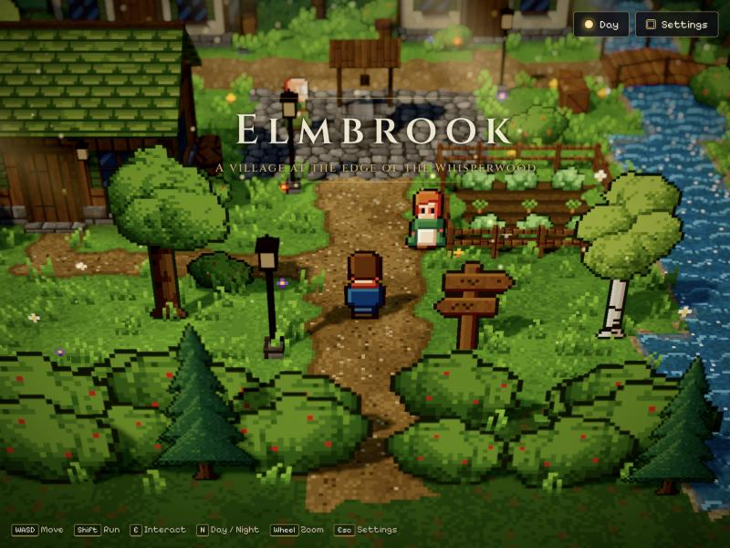
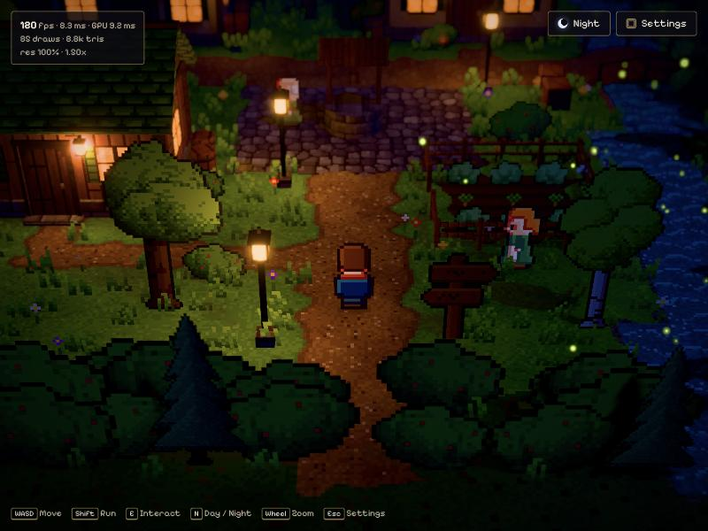
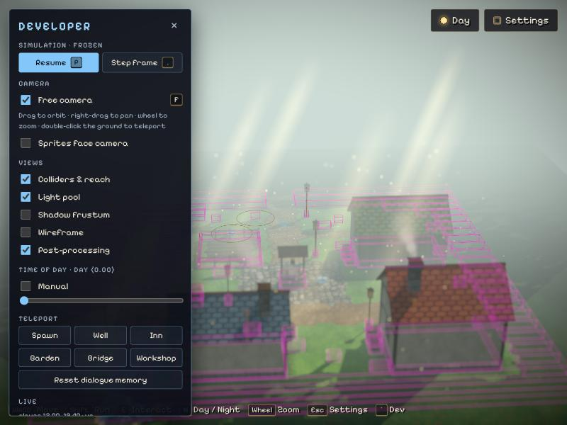
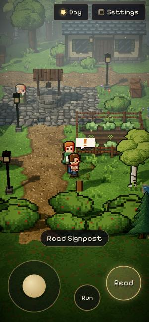

# Elmbrook — HD-2D village demo

A browser HD-2D tech demo in the visual language of *Octopath Traveler*: pixel-art sprites in a
lit 3D diorama with shadows, warm lanterns, fog, bloom and tilt-shift depth of field.






**Stack:** Three.js 0.186 · React Three Fiber 9 · @react-three/postprocessing 3 · TypeScript ·
Vite 8 · WebGL 2. No backend and no external art: every sprite and texture is generated
procedurally at startup (≈200 ms), and all sound is synthesized with the Web Audio API.

```bash
npm install
npm run dev        # http://localhost:5173
npm run build      # type-check + production bundle in dist/
npm run preview    # serve the production bundle
```

## Controls

| Key | Action |
| --- | --- |
| WASD / arrow keys | Walk (four-directional facing) |
| Shift | Run |
| E / Space / Enter | Talk, read, advance dialogue |
| N | Toggle day / night |
| M | Mute / unmute sound |
| Mouse wheel | Zoom |
| Esc | Graphics settings |
| ` (backquote) or F2 | Developer tools |

On phones and tablets an analog stick, a **Talk/Read** button and a hold-to-**Run** button appear
automatically (toggle under Settings → *On-screen touch controls*). Tap the dialogue box to
advance it.

## What's in the scene

A 24 × 24-unit village clearing: three timber-framed houses, a cobbled plaza with a well, a
fenced garden, a creek with an arched bridge, street lamps and a forest border.
You can talk to **Elder Rowan** (stationary, by the well) and **Mira** (walks a patrol route
around the garden), and read the **signpost** and the **old well**. NPC lines change at night and
on repeat visits.

## How it is built (by phase)

### 1. Rendering proof of concept
- **Camera**: perspective, 30° FOV, fixed 34° pitch, smoothed follow with look-ahead, clamped to
  the village (`src/scene/CameraRig.tsx`).
- **Pixel art in 3D**: 16 texels per world unit everywhere, nearest-neighbour sampling.
  Characters are 16×24 sprite sheets (4 directions × idle/walk) painted part by part with
  hue-shifted shading and auto outlines (`src/gfx/characterSprites.ts`).
- **Billboards** stand upright with normals tilted toward the sky so they pick up the same light
  as the ground; alpha-tested (not blended) so depth sorting is always correct, and they cast
  sprite-shaped shadows (`src/gfx/materialPatches.ts`).
- **Depth-aware occlusion**: buildings and trees between the camera and the player get a dithered
  see-through hole around the player (screen-space ellipse + depth test in a material patch).

### 2. Visual fidelity
- Sun/moon with PCF shadows on a tight frustum that follows the player, snapped to shadow texels
  to stop edge crawl; hemisphere sky light; fog; baked contact AO in the ground texture.
- Day ↔ dusk ↔ night keyframes drive every light, fog colour, window glow, bloom strength and
  particle mix (`src/scene/timeOfDay.ts`).
- Lanterns and windows are emissive and feed bloom. Up to 8 lantern sources share a small pool of
  real point lights assigned to the nearest lamps each frame, with distance-based fades so
  reassignment never pops (`src/scene/Lamps.tsx`).
- Post stack: depth of field focused on the player with a sharp focus plateau (the tilt-shift
  diorama look), mipmap bloom, neutral tone mapping, light grade, vignette (`src/scene/Effects.tsx`).
- Atmosphere: dust motes and god rays by day, fireflies by night, chimney smoke, swaying grass and
  flowers, scrolling pixel water.

### 3. Basic gameplay
- Edge-triggered, consumable input (`src/game/input.ts`); most-recent-key four-way facing.
- Circle-vs-box collision with sub-stepping and sliding over a tile-bucketed box list
  (`src/game/world/collision.ts`); the bridge deck arches and characters follow its height.
- NPCs: idle look-around, waypoint patrol, stop and face the player when blocked or spoken to.
- Interactions pick the nearest target in front of the player; dialogue has a typewriter reveal,
  multi-page lines and a pixel-art prompt balloon above the target.

### 4. Browser optimisation
- The whole ground is one baked texture and one draw call; houses are merged per material;
  trees, bushes, grass, flowers and crops are instanced from a single sprite atlas.
- Shaders are compiled up front with `KHR_parallel_shader_compile` behind a loading screen, so the
  first frame doesn't freeze the page.
- Quality presets (Low / Medium / High / Ultra) control pixel-ratio cap, shadow map size and
  softness, MSAA, bloom, DoF, god rays, particle and foliage density and the point-light pool;
  individual effects can be toggled. Settings persist in `localStorage`.
- Adaptive resolution scales the render resolution between 50–100 % using GPU frame time
  (`EXT_disjoint_timer_query_webgl2`) when available, frame rate otherwise. It ignores stalls
  and the warm-up after quality changes.
- Frame stats overlay: fps, frame time, GPU time, draw calls, triangles, render scale.
- Code-split bundle: three.js, post-processing and React are separate long-cacheable chunks; the
  game itself is ≈35 kB gzipped. Total ≈380 kB gzipped.

Measured on an Apple M1 Max (1024×768 window, full resolution, adaptive off): GPU time per frame
≈1 ms on Low, ≈3–7 ms on Medium, ≈9 ms on High, ≈11 ms on Ultra; 50–97 draw calls including
shadow and post-processing passes. Treat these as rough figures — Apple GPU clocks vary a lot
between runs.

## Developer mode

Press <kbd>`</kbd> (or <kbd>F2</kbd>, or Settings → *Developer tools*) to open the panel:

| Tool | What it does |
| --- | --- |
| Freeze (P) / Step frame (.) | Stops the simulation clock: characters, NPC AI, water, grass, particles, lamp flicker and day/night transitions all halt while rendering continues. Step advances exactly one 60 Hz frame. |
| Free camera (F) | Orbit camera: drag to orbit, right-drag to pan, wheel to zoom, double-click the ground to teleport the player. Shows how flat the sprite cards really are. |
| Sprites face camera | Turns every billboard (trees, grass, characters, signpost) toward the free camera. |
| Colliders & reach | Collision boxes, character bodies and interaction ranges (the focused one in yellow). |
| Light pool | All lantern sources and which ones currently hold a real point light. |
| Shadow frustum | The sun's shadow camera as it follows the player. |
| Wireframe | All geometry as wireframe, including every sprite quad. |
| Post-processing | Switches bloom, depth of field and grading off to show the raw render. |
| Time of day | A slider for scrubbing any moment between noon and night. |
| Teleport / reset | Jump to landmarks; reset NPC dialogue memory. |

Closing the panel restores normal play. Everything is driven by one simulation clock
(`src/scene/GameClock.tsx`): animation code reads `runtime.dt` / `runtime.time` instead of the
render loop's delta, which is what makes freezing and stepping exact.

## Sound

`src/game/audio.ts` builds the soundscape from oscillators and filtered noise: wind in the trees,
a creek that gets louder and pans as you approach it, birdsong by day, crickets and owls at night,
footsteps that change on grass, dirt, cobblestones and the wooden bridge, typewriter blips pitched
per speaker, and chimes for dialogue and day/night changes. Audio starts on the first key press or
tap, as browsers require.

## Debugging

- `?sprites` — shows every generated sprite sheet and texture, scaled up (`&scale=6` to zoom).
- Settings → *Show frame stats* — live performance overlay.
- In dev builds, `window.__hd2d` exposes the renderer, scene, camera, stores, the interaction
  registry and the sound engine.

## Project layout

```
src/
  game/        input, settings, game state, developer state, sound, dialogue/interactions, map,
               layout, collision
  gfx/         procedural pixel art (characters, props, surfaces, terrain), mesh builder,
               shader patches
  scene/       R3F components: game clock, camera, lighting, terrain, buildings, props, lamps,
               vegetation, characters, atmosphere, post-processing, performance, dev tools
  ui/          HUD: dialogue box, prompt, banner, settings, stats, touch controls,
               developer panel, sprite debug view
```

## Not yet done

- Hand-drawn sprite art: the procedural sprites are stand-ins; drop in sprite sheets with the same
  16×24 frame layout (`FRAMES` × `DIR_ROWS` in `characterSprites.ts`) to replace them.
- A WebGPU renderer path.
